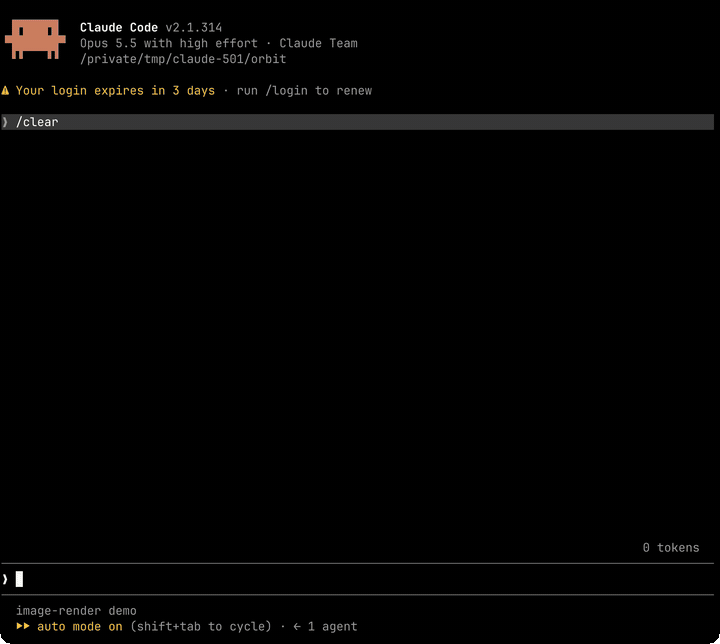
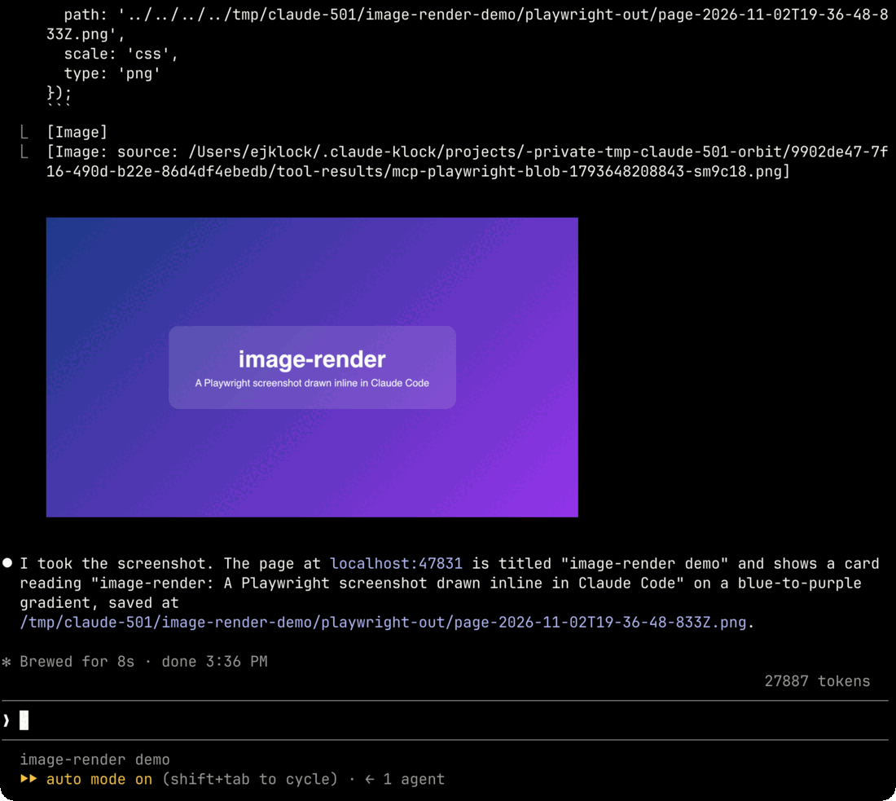
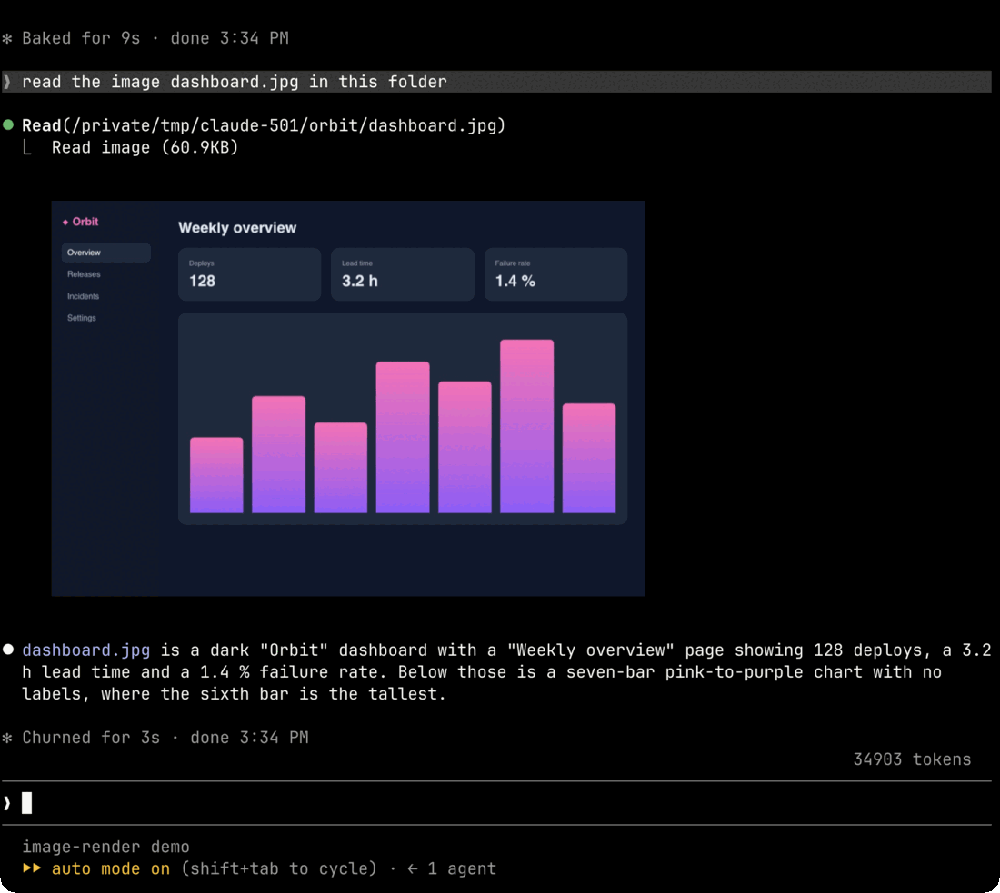

# image-render: images drawn inline in Claude Code

[](https://github.com/ejklock/claude-image-render/actions/workflows/ci.yml)
[](https://github.com/ejklock/claude-image-render/releases)
[](LICENSE)
[](https://docs.claude.com/en/docs/claude-code/plugins)

**image-render** is a Claude Code plugin that draws the images Claude Code
reads, right under the tool row in the terminal transcript. A `Read` of a
PNG, JPEG, GIF or WebP, and a screenshot that an MCP tool such as Playwright
returns, show up as pictures instead of a file name or a line of alt text.

It uses the mods API's `ui.Image` on terminals that speak the kitty graphics
protocol (Ghostty, kitty, WezTerm).



## Quick install

In Claude Code, run:

```
/plugin marketplace add ejklock/claude-image-render
/plugin install image-render@image-render
```

Or in one line:

```
/plugin install image-render --marketplace ejklock/claude-image-render
```

**Requirements:** Claude Code with the mods API (tested on 2.1.314) and a
terminal that speaks the kitty graphics protocol. `sips` on macOS or
ImageMagick's `magick` is needed only for JPEG, GIF, WebP and PNGs over
2 MiB.

## What it draws

Every picture is at most 60 columns wide, narrower on a narrow or short
terminal, and sits under Claude Code's own tool row, which stays as it is.

| Where | What | How it is drawn |
| --- | --- | --- |
| `Read` of a PNG | The image the tool returned | From the returned bytes |
| `Read` of a JPEG, GIF or WebP | The file at the `Read`'s `file_path` | Converted to a PNG with `sips`, or `magick` when `sips` fails, then drawn |
| An MCP tool's result (a browser screenshot, say) | Each PNG image block, one picture per block | From the block's bytes |
| The codemode tool, or any result that names a saved picture in an `[Image: source: <path>]` line | The picture Claude Code saved in its own `tool-results` folders | From the saved file: a `.png` as it is, a `.jpg`, `.jpeg`, `.gif` or `.webp` converted; a file with another extension is left as Claude Code draws it |
| A PNG over 2 MiB, such as a full-page screenshot | The saved file of an MCP picture, or the `file_path` of a `Read` | Shrunk to a PNG at most 1024 pixels on its longer side, then drawn |

When neither converter can read a file, the row renders as Claude Code draws
it. Other files, other image blocks and other tools render exactly what
Claude Code draws.

A screenshot from a browser MCP tool:



A JPEG that `Read` returned:



## Terminals

- **Ghostty, kitty and WezTerm** speak the kitty graphics protocol and draw the
  pictures.
- **herdr** identifies itself as libghostty, so Claude Code does not detect
  kitty graphics there and draws only the alt text. Start Claude Code with
  `CLAUDE_CODE_FORCE_TERMINAL_IMAGES=1`:

  ```sh
  CLAUDE_CODE_FORCE_TERMINAL_IMAGES=1 claude
  ```

  The plugin sends each picture as data, not as a file name, which herdr
  forwards.
- **Any other terminal** renders exactly what Claude Code draws.

## What it never does

- It rewrites nothing that the model, the session log or the prompt sees: it
  only adds a picture to what the terminal shows.
- It uses no network, and no image data leaves the machine.
- It reads a path named by an `[Image: source: <path>]` line only when the path
  lands, symbolic links resolved, in Claude Code's own `tool-results` folders
  (`<config dir>/projects/<project>/<session>/tool-results/`); a relative path,
  a `..` segment or a symbolic link out of the folder is refused. Beyond those
  it reads only the file a `Read` already read (to convert a JPEG, GIF or WebP,
  or shrink a PNG over 2 MiB) and its own scratch PNG under
  `$TMPDIR/image-render/` (`/tmp/image-render/` when `TMPDIR` is unset), which
  it removes.
- It draws from bytes, never from a file name.

## How it works

The plugin is a Claude Code mods hook module
([hooks/register.tsx](hooks/register.tsx)). It hooks `ui.render` for
`ToolUse`, and for a finished `Read` or MCP call that yields a picture it
renders the engine's own row followed by a `ui.Image` of the PNG bytes.

## Development

```sh
npm ci
claude plugin validate .
claude plugin test .
claude --plugin-dir .  # try the working copy in a session
```

## License

MIT, see [LICENSE](LICENSE).
